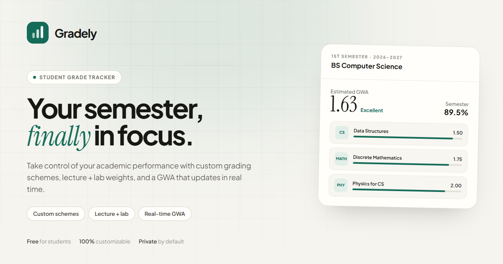

# Gradely

A simple, student-focused grade tracker for keeping scores, courses, and grades in one
place.



## What it does

- **Grade setups** — choose how class work, labs, terms, and activities count, then reuse
  the setup for other courses.
- **Automatic math** — enter points or a percentage. Gradely handles the activity, term,
  semester, and overall averages.
- **Your grade scale** — match the percentage ranges and grades your school already uses.
- **Overall average** — see a GPA/GWA-style average across all your courses.
- **Student accounts** — Supabase email/password auth with Row Level Security on every
  table. Students can only read and write their own data.
- **Dark and light mode**, mobile-first dashboard, and no spreadsheet maintenance.
- **Guided dashboard tour** — a first-visit walkthrough built with Driver.js, restartable
  from the menu at any time.
- **SEO ready** — semantic landing page, Open Graph/Twitter images, structured data
  (`WebApplication` + `FAQPage`), `robots.txt`, and a sitemap.

## Tech stack

- React 19 + Vite 8
- Tailwind CSS v4 (`@tailwindcss/vite`)
- Supabase (`@supabase/supabase-js`)
- Lucide React icons
- React Router
- Driver.js product tour

## Run locally

```bash
npm install
npm run dev
```

Open `http://localhost:5173`.

The repository includes a `.env` with the Supabase URL and **publishable** key used by
this app. Publishable keys are designed to be exposed in browser code; Row Level Security
is what protects the data. Never put a `service_role`/secret key in a `VITE_` variable.

```env
VITE_SUPABASE_URL=https://your-project-ref.supabase.co
VITE_SUPABASE_PUBLISHABLE_KEY=sb_publishable_your_key
VITE_SITE_URL=https://your-domain.com
```

## Supabase setup (one time)

The app includes a built-in setup screen that appears when the database tables are
missing. It can copy or download the schema for you.

1. Open your project's **SQL Editor**.
2. Paste the contents of [`supabase/migrations/0001_init.sql`](supabase/migrations/0001_init.sql)
   and run it. The script is idempotent.
3. Under **Authentication → URL Configuration**, set:
   - **Site URL:** your deployed URL (for local work: `http://localhost:5173`)
   - **Redirect URLs:** `http://localhost:5173/**` and
     `https://gradelyclass.space/**` (required for signup confirmation and password
     reset links)
4. Under **Authentication → Providers → Email**, enable email/password. If "Confirm
   email" is on, students will receive a confirmation link before their first sign-in.
5. Return to the app and click **Check again** if the setup screen is still open.

### What the migration creates

| Table | Purpose |
| --- | --- |
| `grading_schemes` | Lecture/lab split, term weights, component weights, owner |
| `scale_mappings` | Percentage ranges → grade point + remarks |
| `subjects` | Course code, name, units, semester, scheme, lab flag |
| `grade_entries` | Term, component, optional label, score, max score |

RLS is enabled on all four tables. `scale_mappings` is protected through ownership of its
parent scheme. The migration also adds indexes, API grants, and an `updated_at` trigger.

## How the math works

1. **Component average** = `sum(scores) / sum(max scores)` for the component.
2. **Lecture / lab average** = weighted average of the components that have scores. Missing
   components are excluded and the remaining weights rebalance, so a grade appears before
   the whole term is finished.
3. **Term grade** = `(lecture average × lecture weight + lab average × lab weight) / 100`.
   Subjects without a lab use the lecture average only.
4. **Semester grade** = weighted average of the recorded terms. If only two terms have
   scores, the term weights rebalance across those two until the rest are graded.
5. **GWA** = unit-weighted average of the grade points returned by each scheme's scale.
   If subjects use different scales, the GWA is an estimate across those scales.

Gradely shows three status tags based on the percentage: **Pass** (80%+), **Fair**
(75–79.99%), and **Needs improvement** (below 75%). The tags are visual only — the grade
point and remarks always come from the scheme's own scale.

## SEO

- `index.html` contains the title, description, keywords, canonical URL, Open Graph and
  Twitter tags, and two JSON-LD blocks (`WebApplication` and `FAQPage`).
- `public/og-image.png` is a 1200×630 social image generated for the project.
- `public/robots.txt` allows the landing page and disallows `/app` and `/auth`.
- `public/sitemap.xml` lists the landing page.
- App and auth routes set `noindex` at runtime via `useSeo`.
- **Set `VITE_SITE_URL` once** (no trailing slash). Canonical/Open Graph tags in
  `index.html` use the `%VITE_SITE_URL%` placeholder, and
  `scripts/generate-seo.mjs` rewrites `robots.txt` and `sitemap.xml` in `dist/` during
  `npm run build`. The files under `public/` are development fallbacks.

## Deploy

The app is a single-page app, so the host must rewrite unknown routes to `index.html`.

- **Vercel:** `vercel.json` is included with the rewrite and basic security headers.
- **Netlify:** `public/_redirects` is included.
- **Any static host:** add a catch-all rewrite to `/index.html`, and set the three
  `VITE_` environment variables at build time. Set `VITE_SITE_URL` to
  `https://gradelyclass.space` so the build emits the right canonical, sitemap, and
  robots URLs.

```bash
npm run build
npm run preview
```

## Security notes

- Auth is handled entirely by Supabase; this app never stores passwords.
- Every query is scoped by RLS. A user cannot read another student's schemes, subjects,
  or scores.
- Only the publishable key is committed. Keep any secret key out of the repo and out of
  your hosting provider's public environment variables.
- If an account password was ever shared outside your password manager, rotate it.

## Project structure

```text
src/
  components/       UI primitives, app shell, forms, scheme editor, subject card
  context/          Auth, data, theme, toast providers
  hooks/            Dashboard Driver.js tour
  lib/              Supabase client, grading engine, SEO hook, utilities
  pages/            Landing, Auth, Dashboard, Subjects, SubjectDetail, Schemes
  App.jsx           Route guards and lazy-loaded routes
  index.css         Tailwind v4 theme tokens, light/dark variants, base styles
supabase/migrations/0001_init.sql
public/             favicon, social image, robots, sitemap, manifest, redirects
```

## Scripts

| Command | Description |
| --- | --- |
| `npm run dev` | Start the Vite dev server |
| `npm run build` | Build for production into `dist/` |
| `npm run preview` | Preview the production build locally |
